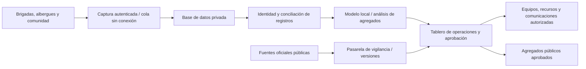

# Territorio Preparado: servidor propio, IA local y vigilancia

Actualización: 9 de octubre de 2026.

La propuesta evoluciona hacia una plataforma de operaciones para entidades territoriales: vigilar señales oficiales, preparar espacios, consolidar reportes de damnificados, coordinar recursos y recuperar el uso cotidiano de los espacios. La Secretaría de Gestión del Riesgo y sus equipos pueden contratar un piloto con infraestructura bajo su control.

## Solución y propuesta de valor

El servidor de la entidad aloja la aplicación, la base de datos y el modelo de IA. La inferencia y el análisis de datos privados se realizan localmente, sin APIs comerciales de IA y sin enviar registros de personas a proveedores externos. El software organiza información dispersa, reduce doble conteo, presenta necesidades y mantiene la trazabilidad de las decisiones. La promesa comercial es mayor control de los datos y coordinación más oportuna, con resultados medidos en un piloto.

Los conectores oficiales son entradas de información pública; no son servicios de inferencia. La independencia de APIs comerciales de IA no equivale a desconectarse de las fuentes oficiales. La red privada mantiene los datos sensibles; una pasarela separada recibe boletines públicos y solo permite salidas autorizadas. El portal público puede publicar agregados aprobados, nunca registros personales por defecto.

## Arquitectura de despliegue propuesta



En producción: red privada/VPN; autenticación y permisos por rol; cifrado de tránsito y almacenamiento; auditoría de accesos; respaldo cifrado, política de conservación y recuperación probada. La información privada no se expone directamente a Internet. Estas medidas están diseñadas como requisitos de producción; el demostrador actual no implementa la totalidad de estos controles y solo acepta datos sintéticos.

Para operación 24/7: UPS y autonomía eléctrica dimensionada, dos nodos o equipo de reemplazo, monitoreo, reinicio automático, copias verificadas y pruebas de recuperación. Un servidor único encendido no garantiza disponibilidad: el piloto debe fijar y medir un SLA, RTO y RPO. Las estaciones conservan capturas pendientes durante cortes de conectividad. Cartografía, datos operativos y protocolos se distribuyen localmente. El mapa existente aún usa teselas externas de OpenStreetMap y enlaces externos; el despliegue independiente requiere hospedar teselas y demás recursos necesarios. Las fuentes oficiales nuevas siguen necesitando conectividad o canales alternos.

## Conteo de damnificados y rol de la IA

El censo proviene de reportes, no de un conteo generado por el modelo. Separar: reportes recibidos, personas únicas registradas, hogares, necesidades, pendientes de identificación y casos conflictivos. No extrapolar los registrados a todos los damnificados sin metodología de cobertura.

La deduplicación exacta usa identificadores legítimos con controles de acceso. La IA puede proponer coincidencias ambiguas, detectar inconsistencias, clasificar necesidades y resumir agregados; las fusiones de identidad requieren revisión. El LLM no calcula ni reemplaza el conteo verificado. Evaluar precisión, falsos duplicados, omisiones, cobertura y tiempo de actualización. El entrenamiento o ajuste posterior debe usar datos autorizados, evaluación representativa y reglas de conservación, sin incorporar automáticamente registros personales al entrenamiento.

Demo incorporada: 128 reportes sintéticos, 104 identificadores únicos, 24 registros repetidos y 32 hogares. La consolidación funciona en el servidor local con Python y registra agregados en SQLite. Es conciliación determinista, no inferencia de IA. Un conector opcional permite consultar un modelo instalado en Ollama en 127.0.0.1:11434; si no está configurado, informa que no se ejecutó IA y mantiene el conteo disponible. Solo envía agregados sintéticos al modelo.

## Vigilancia: información antes, durante y después

Inundación e incendio: recepción de pronósticos, niveles y boletines oficiales; reglas y protocolos acordados con la entidad. Sismo: recepción de detección o alerta temprana de redes oficialmente disponibles. La alerta sísmica temprana ocurre después de iniciarse el sismo y puede preceder a la sacudida en ciertos lugares; no es una predicción de fecha, epicentro o magnitud antes de la ruptura. No prometer anticipación garantizada ni cobertura sin acuerdos técnicos. La plataforma conserva emisor, hora del evento, hora de recepción, versión y territorio, y distingue capturas archivadas de señales vigentes.

Fuentes: [USGS: alerta temprana](https://www.usgs.gov/programs/earthquake-hazards/science/earthquake-early-warning-overview) y [USGS: predicción de terremotos](https://www.usgs.gov/faqs/can-you-predict-earthquakes).

### De Cali a otros territorios: Panamá como ejemplo de adaptación

El evento del 9 de octubre de 2026 se incorpora como ejemplo real de boletín versionado, no como alerta activa del prototipo. El registro archivado guarda el reporte preliminar M8,0 / 33 km y la revisión consultada M7,7 / 12,647 km. Hora de origen: 12:56:06 UTC−5; consulta: 14:21:40 UTC−5. El valor puede cambiar después del corte. Fuente: [USGS, evento us6000u18k](https://earthquake.usgs.gov/earthquakes/eventpage/us6000u18k), alias inicial pt26282000; datos exactos y corte en `frontend/dist/data/panama-2026-10-09.json`.

El flujo propuesto en Panamá recibiría el boletín, cruzaría la afectación con cartografía e inventarios locales, abriría el seguimiento de reportes, consolidaría personas registradas y recursos, y apoyaría la coordinación conforme a protocolos de SINAPROC. No hay conector en vivo, convenio ni despliegue en Panamá implementado en esta entrega.

## Expansión por países

Conservar motor de reportes, conciliación, IA local y tablero; sustituir el paquete territorial: límites, inventarios, amenazas, idioma, normativa, fuentes oficiales y organismos de respuesta. Cali es el demostrador actual. Panamá es el caso de adaptación propuesto. Validar el contexto territorial antes de ofrecer simulaciones o recomendaciones equivalentes; la maqueta de Cali no representa otros países.

## Piloto y evidencia para vender

1. Acordar territorio, actores, propósito y conjunto autorizado de datos.
2. Instalar infraestructura privada, modelo local y controles de acceso.
3. Conectar fuentes oficiales, normalizar cartografía y ensayar desconexiones.
4. Validar conteos contra un censo revisado, casos ambiguos y cobertura.
5. Medir tiempos de consolidación/coordinación, precisión y disponibilidad.
6. Entregar operación, soporte y capacitación; escalar con resultados del piloto.

## Ejecutar el demostrador

```bash
python3 servidor/server.py --port 4180
```

Abrir http://127.0.0.1:4180/operations.html o usar **07 Centro de operaciones** desde la app. El servidor se enlaza únicamente a loopback y no recibe censos reales. Para ensayar el conector a un modelo previamente instalado en Ollama: establecer `TP_LOCAL_MODEL` al nombre local. No instala, entrena ni descarga automáticamente modelos. El frontend también funciona en hosting estático: en ese caso el conteo se ejecuta en el navegador y la interfaz lo identifica claramente.

## SICC, participación de las JAC y difusión móvil

El SICC (Sistema Integrado de Cultura Ciudadana) articula tres etapas: **vigilancia y preparación**, **respuesta** y **recuperación**. La cultura ciudadana y la participación comunitaria atraviesan todo el ciclo. Las Juntas de Acción Comunal (JAC) son actores principales: recopilan reportes y promueven preparación familiar; enlazan necesidades del barrio con equipos durante la respuesta; y participan en seguimiento y recuperación de espacios.

La integración propuesta conecta señales oficiales y análisis de IA local con el servidor de alertas, las pasarelas de los operadores móviles y la población. El objetivo es vincular a todos los operadores del territorio para difusión celular (Cell Broadcast) y canales complementarios acordados. El servidor mantiene colas, identificadores, vigencia, reintentos y trazabilidad por operador. Las alertas siguen protocolos oficiales y territoriales; no se generan predicciones sísmicas a partir de un LLM.

Un servidor propio no garantiza por sí solo recepción universal. Se requieren acuerdos de integración, pasarelas compatibles, capacidad y disponibilidad de las redes, cobertura y equipos receptores compatibles. Un acuse de la pasarela acredita aceptación técnica, no lectura individual por la población; no inventar porcentajes de entrega ni llamar confirmación de recepción a un envío encolado. La difusión celular es una integración con telecomunicaciones, distinta de las APIs comerciales de inferencia de IA.

Fuente técnica: [GSMA: Cell Broadcast para sistemas de alerta temprana](https://www.gsma.com/solutions-and-impact/connectivity-for-good/mobile-for-development/gsma_resources/cell-broadcast-for-early-warning-systems-a-review-of-the-technology-and-how-to-implement-it/). En la entrega, el flujo se presenta en la propuesta y el pitch; no hay conexión activa con operadores ni mensajes reales enviados.
